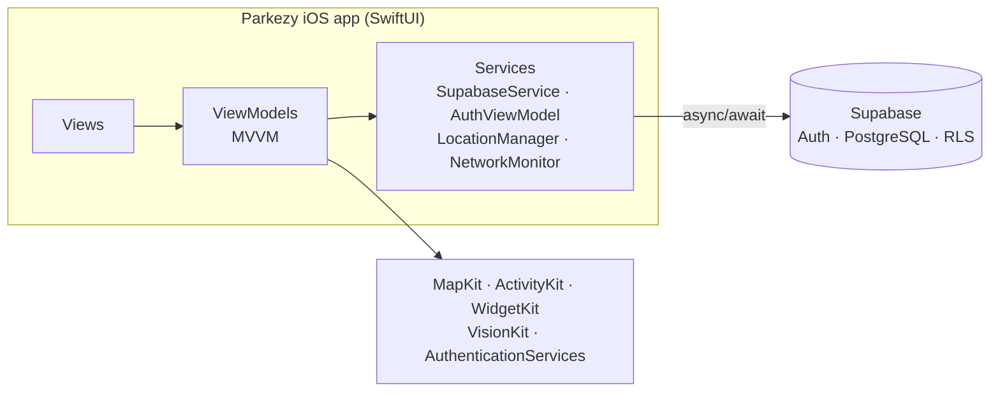

<div align="center">

# Parkezy

**Find, book and unlock a parking spot in seconds, or earn from the one you don't use.**


</div>

---

Parkezy is an iPhone app for parking, built natively with Swift and SwiftUI. One account can switch between two roles:

- **Driver mode** finds nearby parking, books a spot and tracks the session on the Lock Screen and Dynamic Island.
- **Host mode** lists a private driveway or garage, or a commercial facility, and manages its bookings from a dashboard.

Parkezy is iOS only. There is no Android app, and none is planned in this repository.

## Contents

- [Features](#features)
- [Architecture](#architecture)
- [Tech stack](#tech-stack)
- [Project structure](#project-structure)
- [Getting started](#getting-started)
- [Demo mode](#demo-mode)
- [Roadmap](#roadmap)
- [Security and privacy](#security-and-privacy)
- [License](#license)

## Features

### Driver mode

| Feature | Details |
|---|---|
| **Map search** | `UnifiedMapView` shows nearby spots with live availability, using MapKit and Core Location |
| **Spot details** | A sheet with the spot's information, shown from the map |
| **Booking** | Pick a spot and a duration, then start a `BookingSession` |
| **Active session** | Track the current booking in `ActiveSessionView` |
| **Live Activities** | Timer, overstay warning and running cost on the Lock Screen and Dynamic Island (`ParkingLiveActivity`, WidgetKit and ActivityKit) |
| **QR access** | `QRDisplayView` shows a code for entering or leaving a closed space |
| **Receipts** | `ReceiptView` shows the total and any overstay fee |
| **Disputes** | Report a problem with a booking (`DisputeView`) |

### Host mode

| Feature | Details |
|---|---|
| **Dashboard** | `UnifiedHostDashboardView` summarises bookings, income and active sessions |
| **Private listings** | Driveways and home garages (`PrivateParking`, `PrivateListingDetailView`) |
| **Commercial facilities** | Malls, hospitals and offices (`CommercialParking`, `CommercialFacilityDetailView`) |
| **QR scanning** | `QRScannerView` uses VisionKit to check drivers in and out |

### Account and app-wide

- Sign in with email or Apple (`AuthenticationView`, `AuthenticationServices`, `CryptoKit`).
- In-app account deletion.
- Session restore on launch.
- An offline banner when the network drops (`NetworkMonitor`, `NWPathMonitor`).
- Loading, empty and error states on list screens.

## Architecture



- **MVVM.** Views read state from view models. Services handle all data access.
- **Supabase** provides authentication, the PostgreSQL database and row-level security.
- **Apple frameworks** provide maps, location, Live Activities, QR scanning and Apple sign-in.

### Database tables

| Table | Holds |
|---|---|
| `profiles` | User profile, created automatically by a Postgres trigger on sign-up |
| `private_listings` | Driveways and home garages |
| `commercial_facilities` | Commercial lots |
| `bookings` | Bookings and their status |
| `disputes` | Booking disputes |

## Tech stack

| Layer | Technology |
|---|---|
| UI | SwiftUI, `DesignSystem.swift` for shared colours, type and spacing |
| Architecture | MVVM with a central services layer, Swift concurrency (`async`/`await`) |
| Maps and location | MapKit, Core Location |
| Live tracking | ActivityKit, WidgetKit |
| Scanning | VisionKit |
| Sign-in | AuthenticationServices (Sign in with Apple), CryptoKit |
| Backend | Supabase (Auth, PostgreSQL, row-level security) |
| Connectivity | Network framework (`NWPathMonitor`) |

## Project structure

```text
parkezy-2.0/
├── parkezy/
│   ├── parkezy.xcodeproj        Xcode project
│   └── parkezy/                 App source
│       ├── Backend/             Supabase config, services, auth, secrets template
│       ├── Components/          Shared SwiftUI components
│       ├── Assets.xcassets/     Colours and images
│       └── *.swift              Views, view models and models for each feature
├── PARKEZY_CHANGELOG.md         Release history
├── SUBMISSION_CHECKLIST.md      App Store submission checklist
└── parkezy_audit_report.md      Architecture audit
```

## Getting started

### Requirements

- A Mac with Xcode that supports the iOS 18 SDK
- An iPhone or simulator running iOS 18 or later
- A Supabase project (free tier is enough for development)

### 1. Open the project

```bash
open parkezy-2.0/parkezy/parkezy.xcodeproj
```

### 2. Add your Supabase keys

`Secrets.swift` is ignored by git, so it is never committed. Create it from the template:

```bash
cp parkezy-2.0/parkezy/parkezy/Backend/Secrets.swift.example parkezy-2.0/parkezy/parkezy/Backend/Secrets.swift
```

Then fill in the two values:

```swift
enum Secrets {
    static let supabaseURL = "https://YOUR-PROJECT.supabase.co"
    static let supabaseAnonKey = "YOUR-ANON-KEY"
}
```

Use the **anon** key only. Never put the service-role key in the app.

### 3. Create the database

Create the tables listed under [Database tables](#database-tables) in your Supabase project, with row-level security enabled. The app also expects a trigger that creates a `profiles` row for each new sign-up.

### 4. Run

Select an iPhone simulator in Xcode and press **Run**.

## Demo mode

`DemoMode.swift` lets you explore the app with sample data, without a Supabase project. Use it to check the UI and flows before your backend is ready.

## Roadmap

- **Payments.** Bookings record their cost in the app, but no real payment is taken yet. A payment provider needs a server-side integration.
- **Environments.** Separate development, staging and production Supabase projects, selected in `AppConfig.swift`.
- **Offline resilience.** Cache data locally (SwiftData or Core Data), and move booking conflict handling to server-side functions.

## Security and privacy

- Sign-in uses Supabase Auth and Sign in with Apple.
- Row-level security limits each user to their own data.
- All network traffic uses HTTPS. App Transport Security is not weakened.
- Secrets stay out of git. Only the anon key is in the app.
- Account deletion is available in the app.

Found a security issue? Please report it privately rather than in a public issue.

## License

Released under the [MIT License](LICENSE).
